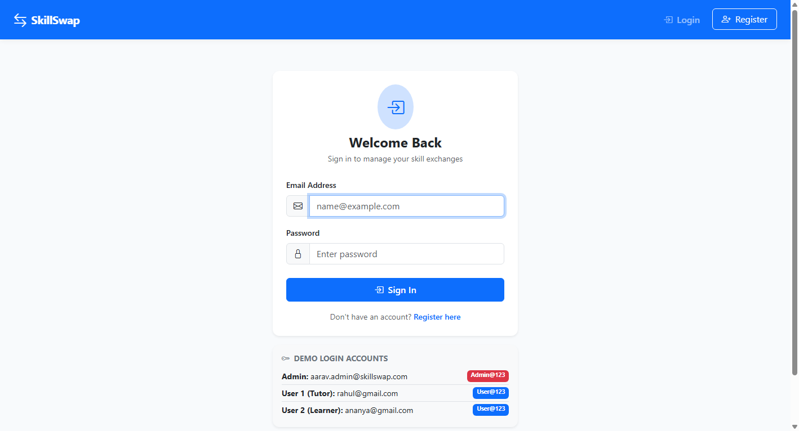
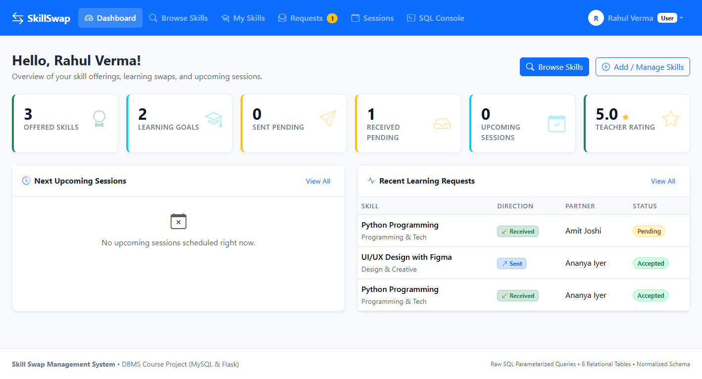
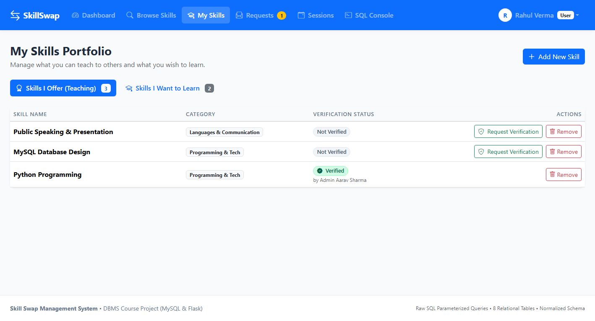
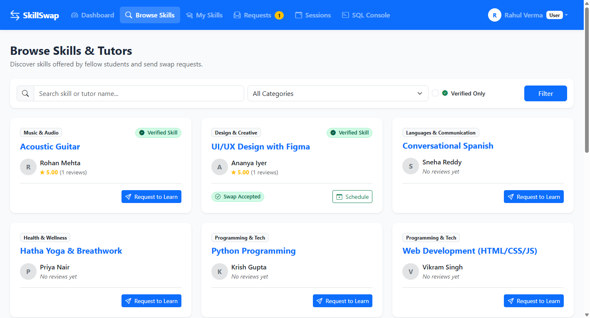
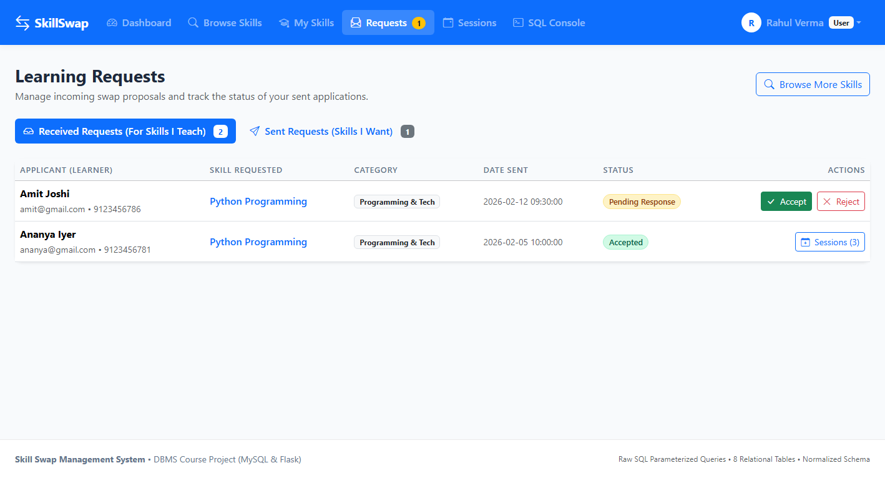
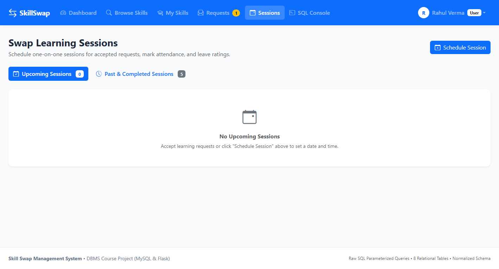
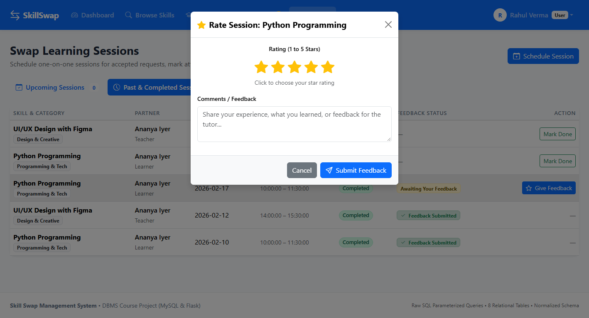
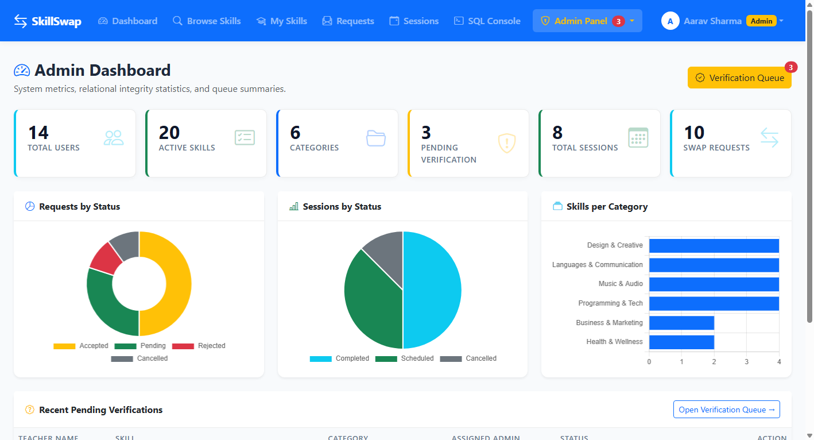
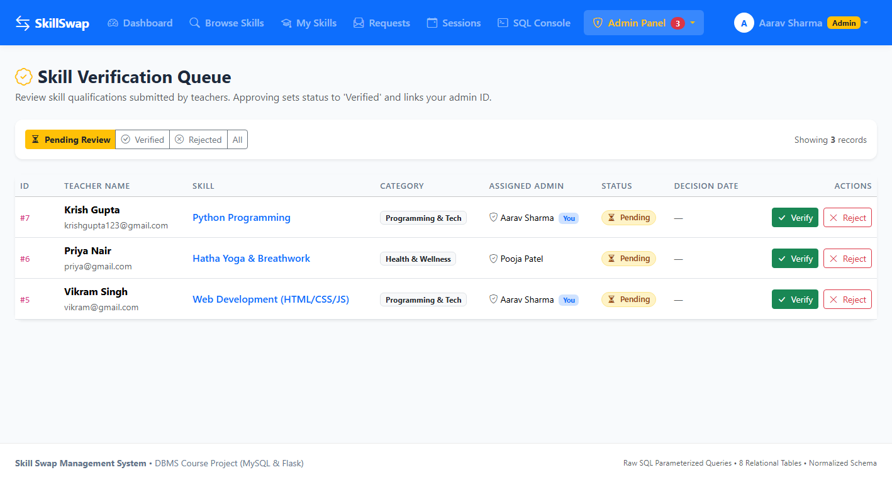

# 15. Application User Interface & System Visuals

This section presents the visual interface and operational workflows of the **Skill Swap Management System**, documenting how the front-end user experience interfaces directly with the relational database schema.

---

### 15.1 User Registration & Authentication Portal

> **Figure 15.1: Secure User Authentication and Onboarding Portal.**  
> *Caption:* The authentication gateway featuring cryptographic credential validation using Werkzeug password hashing. Includes a quick-access credential helper card displaying pre-seeded demonstration accounts across both `User` and `Admin` roles.  
> **Database operations:** `SELECT user_id, password, role FROM \`USER\` WHERE email = %s;` followed by session initialization and role-based redirection.

---

### 15.2 Student Dashboard & Skill Inventory View

> **Figure 15.2: Student Dashboard and Skill Inventory Interface.**  
> *Caption:* **(a)** Real-time student metric dashboard aggregating skills offered, learning targets, pending request counters, upcoming session dates, and cumulative teacher rating scores derived from `FEEDBACK`. **(b)** Dual-pane skill portfolio permitting students to register offerings (`skill_type = 'Offering'`) or learning goals (`skill_type = 'Learning'`). Offering skills display dynamic badge statuses (`Verified`, `Pending Verification`, or `Not Verified`) with a one-click verification request button that executes: `INSERT INTO SKILL_VERIFICATION (user_skill_id, admin_id, verification_status) VALUES (...)`.

---

### 15.3 Global Skill Catalog & Search Interface

> **Figure 15.3: Global Skill Catalog and Search Interface.**  
> *Caption:* Peer-to-peer discovery interface with multi-criteria filtering across skill name keywords, category dropdown selection, and a "Verified Only" qualification toggle. Each tutor card illustrates teacher reputation metrics (average star rating, review volume), category association, verification badge, and contextual action buttons (`Request to Learn` vs. `Swap Accepted`).  
> **Database operations:** Parameterized multi-table `JOIN` across `USER_SKILL`, `\`USER\``, `SKILL`, `SKILL_CATEGORY`, and `FEEDBACK`.

---

### 15.4 Learning Request & Negotiation Workflow

> **Figure 15.4: Learning Request Lifecycle and Negotiation Interface.**  
> *Caption:* Split-tab workflow manager tracking bidirectional swap negotiations. The "Received Requests" tab enables teachers to accept (`status = 'Accepted'`) or decline (`status = 'Rejected'`) incoming proposals. The "Sent Requests" tab permits applicants to cancel active inquiries. Strict constraint handling ensures re-sent proposals update existing rows back to `Pending` under the composite constraint `UNIQUE(requester_id, user_skill_id)`.

---

### 15.5 Session Scheduling & Calendar Interface

> **Figure 15.5: Session Scheduling and Calendar Management Interface.**  
> *Caption:* Interactive scheduling dashboard displaying upcoming one-on-one sessions, chronological slots, participant roles (Teacher vs. Learner), and status badges. The modal dialog enforces database-level validation: verifying `status = 'Accepted'` on the parent swap request, rejecting past dates (`session_date >= CURDATE()`), and checking `end_time > start_time` via table-level `CHECK` constraints.

---

### 15.6 Post-Session Peer Feedback & Rating Modal

> **Figure 15.6: Post-Session Peer Feedback and Rating Modal.**  
> *Caption:* Quality evaluation dialogue accessible exclusively for sessions marked with `status = 'Completed'`. Employs an interactive JavaScript 5-star rating widget and qualitative testimonial textarea. Strictly governed by database rules: only session participants are authorized to submit feedback, ratings are bounded to 1–5 (`CHECK (rating BETWEEN 1 AND 5)`), and duplicate submissions are prevented by `UNIQUE(session_id, reviewer_id)`.

---

### 15.7 Administrator Management & Verification Dashboard

> **Figure 15.7: Administrator Analytics and Verification Queue Dashboard.**  
> *Caption:* **(a)** Administrative command center featuring Chart.js analytics: doughnut distribution of swap request statuses, pie chart of session statuses, and horizontal bar charts of skills per category. **(b)** Skill verification approval queue. Administrators review teacher credentials and mark submissions as `Verified` or `Rejected`, dynamically updating `SKILL_VERIFICATION.admin_id` to the acting administrator with `verification_date = NOW()`.
